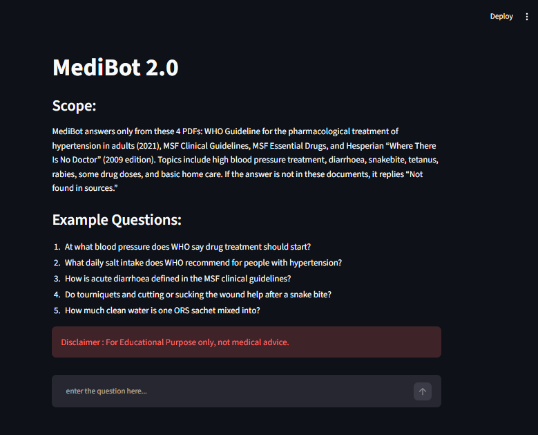
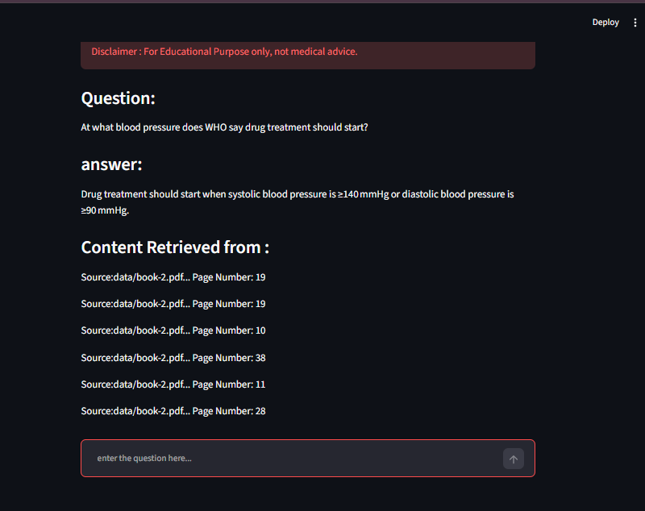
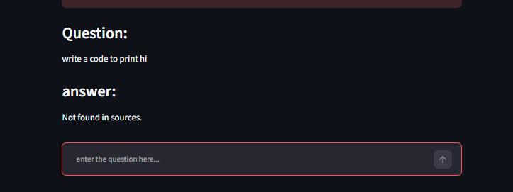

# MediBot v2

A RAG assistant over four medical guideline PDFs. It answers with the source file and page, and replies "Not found in sources." when the documents do not contain the answer.

The main goal of this project is **evaluation**: a 30-question test set, written from the documents before the bot was built, is used to measure retrieval, answer quality and refusal behaviour, with an honest look at the failures.

> **Disclaimer:** For educational purpose only, not medical advice.

## Scope

MediBot answers only from these 4 PDFs: the WHO hypertension guideline (2021), MSF Clinical Guidelines, MSF Essential Drugs, and Hesperian "Where There Is No Doctor" (2009 edition).

Topics include high blood pressure treatment, diarrhoea, snakebite, tetanus, rabies, some drug doses, and basic home care. Anything outside these documents should return "Not found in sources."

The documents are **indexed for retrieval**. The model is not trained on them.

## Example questions

1. At what blood pressure does WHO say drug treatment should start?
2. What daily salt intake does WHO recommend for people with hypertension?
3. How is acute diarrhoea defined in the MSF clinical guidelines?
4. Do tourniquets and cutting or sucking the wound help after a snake bite?
5. How much clean water is one ORS sachet mixed into?

Note: the bot is sensitive to wording. The question "What daily salt limit does the WHO hypertension guideline mention?" failed in manual testing, while the question above (no. 2) worked.

## How it works

1. **Load** the PDFs with `PyPDFLoader` (1,638 pages in total).
2. **Chunk** with `RecursiveCharacterTextSplitter` (chunk size 1000, overlap 250), which gives 3,879 chunks.
3. **Embed** with `BAAI/bge-small-en-v1.5` (local) and store in **Chroma**.
4. **Retrieve** the top-k chunks by similarity.
5. **Answer** with Groq (`openai/gpt-oss-20b`, temperature 0), using only the retrieved context.
6. **Show** the answer, the retrieved sources (file and page) and the disclaimer in a Streamlit UI.

Sources shown in the UI are the retrieved chunks. They are not guaranteed to be the exact chunks the model used.

## Stack

Python, LangChain, Chroma, sentence-transformers (BGE), Groq, Streamlit, python-dotenv.

## Sources (PDFs are NOT in this repo)

| Document | Publisher | Licence | Link |
|---|---|---|---|
| MSF Clinical Guidelines (PDF as downloaded, 409 pages) | MSF | All rights reserved | https://medicalguidelines.msf.org/en/node/170 |
| MSF Essential Drugs (PDF as downloaded, 663 pages) | MSF | All rights reserved | https://medicalguidelines.msf.org/en/node/339 |
| Guideline for the pharmacological treatment of hypertension in adults, 2021 (61 pages) | WHO | CC BY-NC-SA 3.0 IGO | https://www.who.int/publications-detail-redirect/9789240033986 |
| Where There Is No Doctor, 2009 edition (505 pages) | Hesperian Health Guides | Non-commercial copying with credit (see the book's copyright page) | https://www.pseau.org/outils/ouvrages/hesperian_where_there_is_no_doctor.pdf (third-party mirror) |

MSF and Hesperian content belongs to its owners. The PDFs and the vector store are excluded from Git (`data/`, `Knowledge_Base/`).

## Setup

1. Create a virtual environment and install dependencies:
   ```
   pip install -r requirements.txt
   ```
2. Download the four PDFs into `data/` with these file names: `book-2.pdf` (WHO), `guideline-170-en.pdf` (MSF Clinical), `guideline-339-en.pdf` (MSF Essential Drugs), `hesperian_where_there_is_no_doctor.pdf`.
3. Create a `.env` file with your Groq key (never commit it):
   ```
   GROQ_API_KEY=your_key_here
   ```
4. Build the index (run from the repo root):
   ```
   python app/Creating_Knowledge_Base.py
   ```
5. Run the UI (from the repo root, so the `app` package is found):
   ```
   python -m streamlit run UI/streamlit_app.py
   ```

## Project structure

```
app/    answer.py (retrieve + answer), models.py (LLM, judge, embeddings), Creating_Knowledge_Base.py (ingest)
UI/     streamlit_app.py
evals/  test_set.json, retrieval_eval.py, refusal_evals.py, answer_correctness.py, judge_eval.py, results.json
data/   PDFs (not committed)
```

## Evaluation

### Test set

`evals/test_set.json` has 30 questions: 20 answerable, 5 "trap" questions (dosages and similar-looking numbers), and 5 questions that are not in the documents. Each has the correct answer, source file and page.

The questions were written from the PDF text before the bot existed, with LLM assistance, so they do not depend on the bot's answers. Not every question was hand-verified.

### Metrics

- **Retrieval hit rate@k:** the correct file and page appear in the top-k chunks (strict page match, 25 questions).
- **Answer correctness:** an LLM judge (`qwen/qwen3.8-27b`) compares the bot answer with the correct answer (25 questions). The author hand-checked 10 verdicts: 9 of 10 matched the judge.
- **Refusal accuracy:** on the 5 out-of-scope questions, the bot replies "Not found in sources."

### Results

| Run | top-k | Retrieval hit rate | Answer correctness | Refusal (5 out-of-scope) |
|---|---|---|---|---|
| baseline | 4 | 80% (20/25) | 88% (22/25) by judge, 92% (23/25) after one hand correction | 5/5 |
| k6 | 6 | 88% (22/25) | not measured | not measured |

Missed ids: baseline 1, 3, 5, 12, 22; k6 1, 3, 22. Raw numbers are in `evals/results.json`.

### Failure analysis

Wrong answers sorted into three buckets: (1) info not in the documents, (2) info in the documents but not retrieved, (3) retrieved but the answer is wrong.

| Question id | Bucket | What happened |
|---|---|---|
| 3 (WHO: single-pill combination) | 2 | The bot replied "Not found". The WHO recommendation (page 10) was not retrieved. Evidence-section chunks from page 26 and unrelated Hesperian chunks were retrieved instead. |
| 22 (amoxicillin dose for a child) | 2 | The retrieved chunks came from Hesperian and the MSF clinical guideline, not the MSF Essential Drugs page with the expected dose. The bot gave a different dosing regimen. The question is also ambiguous, because different books give different doses. |
| 16 (zinc, vomiting) | judge error | The judge marked it INCORRECT because "within 30 minutes" was missing. The author judged the answer correct. |

Other findings:
- Several hit-rate misses (ids 1, 5, 12) still gave correct answers, because the same fact appears on another page or in another book. Strict page matching under-counts retrieval quality.
- Top-k chunks can contain duplicates or short header chunks (for example, repeated title lines), which waste slots.

## Limitations

- **Small test set.** 25 scored questions plus 5 out-of-scope ones. One question is 4 points, so the 80% to 88% change is a difference of 2 questions and is not a proven improvement.
- **Refusal accuracy is weak evidence.** The 5 out-of-scope questions are far from the documents' topics, so refusing was easy. Questions close to the topic were not tested.
- **Judge bias.** The LLM judge was inconsistent on omitted details (id 16 vs ids 18 and 19). Only 10 verdicts were hand-checked.
- **Single run, no variance.** Bot answers changed between two runs of the same questions (3 of 30), even at temperature 0.
- **Answer correctness was measured only for the baseline.** The k=6 run measured retrieval only.
- **Wording sensitivity.** A rephrased question can miss the right chunk.
- **Ingestion.** `PyPDFLoader` flattens tables, so dose tables and drug lists lose structure. There is no OCR, and the bot works in English only.
- **Maintenance risk.** `langchain-community` (used for `PyPDFLoader`) is no longer actively maintained.
- **Medical risk.** The bot can give a wrong or outdated dose. The Hesperian book is a 2009 edition. Always check the cited source, and do not use this for medical decisions.

## Screenshots

Home page with scope, example questions and disclaimer:



A normal answer with the retrieved sources (file and page):



An out-of-scope question, which returns "Not found in sources." and shows no sources:



## Possible next steps

Improve one thing at a time and re-measure: chunk size, MMR versus plain similarity, cleaner ingestion (remove header chunks), and a loader comparison. Add pytest tests, and test English versus Hinglish questions.